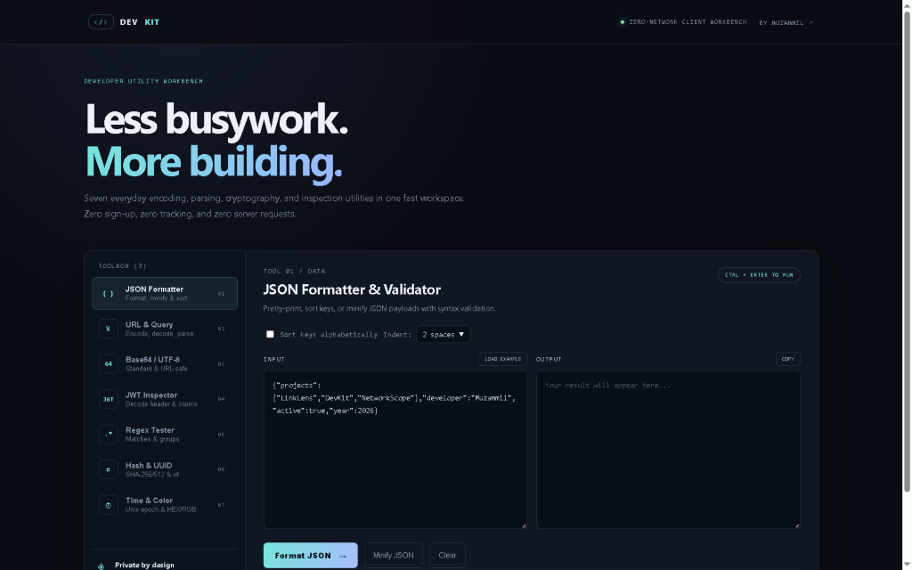

# DevKit — Client-Side Developer Workbench

**DevKit** is a lightweight, zero-network developer utility suite running entirely in the browser with native Web APIs (`JSON`, `URL`, `TextEncoder`, `crypto.subtle`).

---

## Live Demo

- **Production URL:** [https://devkit-toolbox.vercel.app/](https://devkit-toolbox.vercel.app/)
- **Mode:** Live client-side developer toolbox deployed on Vercel.

## Application Preview




## Included Utilities (7 Tools)

1. **JSON Formatter & Validator** — Pretty-print (2/4 spaces), minify, sort keys alphabetically, and surface syntax errors.
2. **URL Encoder / Decoder & Query Parser** — Encode/decode URL components and extract query parameter pairs.
3. **Base64 / UTF-8 Converter** — Full Unicode Base64 encoding/decoding with URL-safe (`-`, `_`) toggle.
4. **JWT Inspector** — Inspect JWT headers, claims payloads, and human-readable `iat`/`exp` timestamps locally.
5. **Regex Tester** — Test JavaScript regular expressions with flags and inspect capture groups.
6. **Hash & UUID Generator** — Compute SHA-1/256/384/512 digests via `crypto.subtle` and generate UUID v4 tokens.
7. **Time & Color Converter** — Convert Unix epochs / ISO-8601 dates and HEX/RGB/HSL color values.

---

## Run Locally & Test

```bash
# Run unit tests (Node 18+)
node --test tests/devkit.test.mjs

# Serve locally
npx serve .
```

---

## Limitations

- JWT Inspector decodes claims for debugging only; it does not verify cryptographic signatures.
- Client-side only: intentionally has no cloud sync or server persistence.

---

## Author

**Muzammil Shabbir** — [GitHub](https://github.com/Muzammil-s) · [LinkedIn](https://www.linkedin.com/in/muzammil-shabbir-7368a7382)
